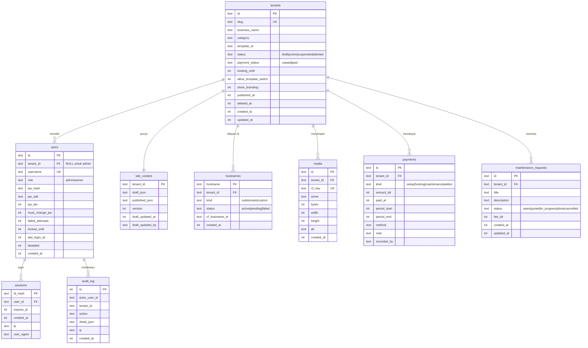

# DATABASE — Skema D1

Versi 1.0 · 18 November 2026 · Database: `umkm-db` (satu D1 bersama untuk semua tenant)

---

## 1. Prinsip

1. **Satu database bersama.** Isolasi tenant dilakukan di layer aplikasi lewat kolom `tenant_id` (D1/SQLite tidak punya Row-Level Security).
2. **ID** memakai teks acak (`nanoid` 21 karakter) — tidak bisa ditebak, tidak membocorkan jumlah pelanggan.
3. **Waktu** disimpan sebagai `INTEGER` Unix epoch milidetik (UTC); tampilan dikonversi ke WIB di UI.
4. **Konten situs** disimpan sebagai **satu dokumen JSON** per tenant (draf & terbit), divalidasi Valibot sebelum ditulis.
5. **Template tidak disimpan di DB** — registri template ada di kode (`packages/templates/registry.ts`); DB hanya menyimpan `template_id`.
6. Semua perubahan skema lewat **migrasi** bernomor (`migrations/0001_init.sql`, …) dengan `wrangler d1 migrations apply`.

## 2. ERD



## 3. DDL (`migrations/0001_init.sql`)

```sql
PRAGMA foreign_keys = ON;

CREATE TABLE tenants (
  id                    TEXT PRIMARY KEY,
  slug                  TEXT NOT NULL UNIQUE
                          CHECK (length(slug) BETWEEN 3 AND 40
                                 AND slug NOT GLOB '*[^a-z0-9-]*'
                                 AND slug NOT LIKE '-%' AND slug NOT LIKE '%-'),
  business_name         TEXT NOT NULL,
  category              TEXT NOT NULL CHECK (category IN ('kuliner','fashion','jasa','cantik','toko','kriya','lainnya')),
  template_id           TEXT NOT NULL,
  status                TEXT NOT NULL DEFAULT 'draft' CHECK (status IN ('draft','active','suspended','deleted')),
  payment_status        TEXT NOT NULL DEFAULT 'unpaid' CHECK (payment_status IN ('unpaid','paid')),
  allow_template_switch INTEGER NOT NULL DEFAULT 1,
  show_branding         INTEGER NOT NULL DEFAULT 1,
  media_quota_bytes     INTEGER NOT NULL DEFAULT 15728640,   -- 15 MB
  media_used_bytes      INTEGER NOT NULL DEFAULT 0,
  publish_count_day     INTEGER NOT NULL DEFAULT 0,
  publish_count_date    TEXT,                                 -- 'YYYY-MM-DD' UTC
  notes                 TEXT,                                 -- catatan internal admin
  hosting_until         INTEGER,                              -- akhir masa hosting; diisi +1 tahun saat publish pertama
  published_at          INTEGER,
  deleted_at            INTEGER,
  created_at            INTEGER NOT NULL,
  updated_at            INTEGER NOT NULL
);
CREATE INDEX idx_tenants_status ON tenants(status);
CREATE INDEX idx_tenants_hosting ON tenants(hosting_until);

CREATE TABLE users (
  id               TEXT PRIMARY KEY,
  tenant_id        TEXT REFERENCES tenants(id) ON DELETE CASCADE,
  username         TEXT NOT NULL UNIQUE COLLATE NOCASE
                     CHECK (length(username) BETWEEN 3 AND 32),
  role             TEXT NOT NULL CHECK (role IN ('admin','owner')),
  pw_hash          TEXT NOT NULL,     -- base64 PBKDF2-SHA256 32 byte
  pw_salt          TEXT NOT NULL,     -- base64 16 byte
  pw_iter          INTEGER NOT NULL,
  must_change_pw   INTEGER NOT NULL DEFAULT 1,
  failed_attempts  INTEGER NOT NULL DEFAULT 0,
  locked_until     INTEGER,
  last_login_at    INTEGER,
  disabled         INTEGER NOT NULL DEFAULT 0,
  created_at       INTEGER NOT NULL,
  CHECK ((role = 'admin' AND tenant_id IS NULL) OR (role = 'owner' AND tenant_id IS NOT NULL))
);
CREATE INDEX idx_users_tenant ON users(tenant_id);

CREATE TABLE sessions (
  id_hash     TEXT PRIMARY KEY,       -- SHA-256 hex dari token cookie
  user_id     TEXT NOT NULL REFERENCES users(id) ON DELETE CASCADE,
  expires_at  INTEGER NOT NULL,
  created_at  INTEGER NOT NULL,
  ip          TEXT,
  user_agent  TEXT
);
CREATE INDEX idx_sessions_user ON sessions(user_id);
CREATE INDEX idx_sessions_expires ON sessions(expires_at);

CREATE TABLE site_content (
  tenant_id         TEXT PRIMARY KEY REFERENCES tenants(id) ON DELETE CASCADE,
  draft_json        TEXT NOT NULL,
  published_json    TEXT,
  version           INTEGER NOT NULL DEFAULT 1,   -- optimistic locking
  draft_updated_at  INTEGER NOT NULL,
  draft_updated_by  TEXT
);

CREATE TABLE hostnames (
  hostname        TEXT PRIMARY KEY COLLATE NOCASE,   -- 'toko.domainku.id'
  tenant_id       TEXT NOT NULL REFERENCES tenants(id) ON DELETE CASCADE,
  kind            TEXT NOT NULL CHECK (kind IN ('subdomain','custom')),
  status          TEXT NOT NULL DEFAULT 'active' CHECK (status IN ('active','pending','failed')),
  cf_hostname_id  TEXT,                               -- Fase 7 (Cloudflare for SaaS)
  created_at      INTEGER NOT NULL
);
CREATE INDEX idx_hostnames_tenant ON hostnames(tenant_id);

CREATE TABLE media (
  id          TEXT PRIMARY KEY,
  tenant_id   TEXT NOT NULL REFERENCES tenants(id) ON DELETE CASCADE,
  r2_key      TEXT NOT NULL UNIQUE,                   -- 't/{tenantId}/{id}.webp'
  mime        TEXT NOT NULL CHECK (mime IN ('image/webp','image/jpeg','image/png')),
  bytes       INTEGER NOT NULL,
  width       INTEGER,
  height      INTEGER,
  alt         TEXT,
  created_at  INTEGER NOT NULL
);
CREATE INDEX idx_media_tenant ON media(tenant_id, created_at DESC);

CREATE TABLE payments (
  id           TEXT PRIMARY KEY,
  tenant_id    TEXT NOT NULL REFERENCES tenants(id) ON DELETE CASCADE,
  kind         TEXT NOT NULL CHECK (kind IN ('setup','hosting','maintenance','addon')),
  amount_idr   INTEGER NOT NULL CHECK (amount_idr >= 0),
  paid_at      INTEGER NOT NULL,
  period_start INTEGER,           -- khusus kind='hosting': periode yang dibayar
  period_end   INTEGER,
  method       TEXT,              -- 'transfer BCA', 'QRIS', 'tunai'
  note         TEXT,
  recorded_by  TEXT NOT NULL,
  created_at   INTEGER NOT NULL
);
CREATE INDEX idx_payments_tenant ON payments(tenant_id, paid_at DESC);

CREATE TABLE maintenance_requests (
  id           TEXT PRIMARY KEY,
  tenant_id    TEXT NOT NULL REFERENCES tenants(id) ON DELETE CASCADE,
  title        TEXT NOT NULL,
  description  TEXT,
  status       TEXT NOT NULL DEFAULT 'open'
                 CHECK (status IN ('open','quoted','in_progress','done','cancelled')),
  fee_idr      INTEGER,
  created_at   INTEGER NOT NULL,
  updated_at   INTEGER NOT NULL
);
CREATE INDEX idx_maint_tenant ON maintenance_requests(tenant_id, status);

CREATE TABLE audit_log (
  id             INTEGER PRIMARY KEY AUTOINCREMENT,
  actor_user_id  TEXT,
  tenant_id      TEXT,
  action         TEXT NOT NULL,   -- 'auth.login','content.save','site.publish','admin.reset_password',...
  detail_json    TEXT,
  ip             TEXT,
  created_at     INTEGER NOT NULL
);
CREATE INDEX idx_audit_tenant ON audit_log(tenant_id, created_at DESC);
CREATE INDEX idx_audit_created ON audit_log(created_at);

-- Status job cron yang dikerjakan bertahap (backup, pembersihan)
CREATE TABLE job_state (
  job         TEXT PRIMARY KEY,   -- 'backup', 'purge_deleted', 'orphan_media'
  cursor      TEXT,
  run_id      TEXT,
  updated_at  INTEGER NOT NULL
);
```

> `audit_log` tidak memakai foreign key agar log tetap ada setelah tenant dihapus.

### Slug terlarang (dicek di aplikasi)

`www, cms, admin, api, media, assets, static, cdn, mail, email, smtp, ftp, app, dev, staging, test, demo, status, help, support, docs, blog, billing, login, auth, root, ns1, ns2, _tpl`

## 4. Skema Konten (`draft_json` / `published_json`)

Didefinisikan sekali di `packages/content-schema` (Valibot) dan dipakai UI & Worker.

```jsonc
{
  "schemaVersion": 1,
  "business": {
    "name": "Warung Bu Sri",            // 1–60
    "tagline": "Masakan rumahan sejak 1998", // 0–100
    "logoMediaId": "m_abc...",          // opsional
    "category": "kuliner"
  },
  "sections": {                          // aktif/nonaktif
    "about": true, "products": true, "gallery": true,
    "testimonials": true, "hours": true, "contact": true, "map": true
  },
  "hero": {
    "title": "Rasa Rumah, Harga Bersahabat",   // 1–80
    "subtitle": "Pesan antar se-Kota Malang",  // 0–160
    "imageMediaId": "m_def...",
    "ctaText": "Pesan Sekarang"                // 0–30 → membuka WhatsApp
  },
  "about": { "title": "Tentang Kami", "body": "…", "imageMediaId": null },  // body 0–1500, teks polos + baris baru
  "products": {
    "title": "Menu Kami",
    "items": [                                  // maks 30
      {
        "id": "p1",
        "name": "Nasi Rawon",                    // 1–60
        "price": 25000,                          // angka IDR, atau null
        "priceText": null,                       // alternatif: "mulai 15rb"
        "description": "Daging sapi empuk",      // 0–200
        "imageMediaId": "m_ghi...",
        "badge": "terlaris",                     // null|terlaris|baru|promo
        "available": true
      }
    ]
  },
  "gallery": { "title": "Galeri", "items": [ { "mediaId": "m_..", "caption": "" } ] },   // maks 20
  "testimonials": { "title": "Kata Pelanggan", "items": [ { "name": "Andi", "text": "…", "rating": 5 } ] }, // maks 10
  "hours": [ { "day": 1, "open": "08:00", "close": "21:00", "closed": false } ],  // day 0=Minggu..6
  "contact": {
    "whatsapp": "6281234567890",                 // E.164 tanpa '+', diawali 62
    "waMessage": "Halo, saya mau pesan",         // 0–200
    "phone": null,
    "email": null,
    "address": "Jl. Mawar No. 5, Malang",        // 0–200
    "mapsUrl": "https://maps.app.goo.gl/xxxx"    // hanya domain Google Maps
  },
  "social": {
    "instagram": "warungbusri",                  // username, bukan URL bebas
    "facebook": null, "tiktok": null, "youtube": null,
    "shopee": null, "tokopedia": null            // URL penuh, domain di-allowlist
  },
  "seo": { "title": null, "description": null, "ogImageMediaId": null }   // null = otomatis dari business/hero
}
```

**Aturan validasi penting**
- Semua string di-`trim`, karakter kontrol dibuang, panjang dibatasi.
- Tidak ada HTML yang diterima — semua teks adalah teks polos (baris baru → `<br>` saat render).
- `mediaId` harus milik tenant yang sama (dicek di server saat simpan).
- URL hanya `https:` dan domainnya di-allowlist (lihat SECURITY.md §5).
- Ukuran JSON maksimum 100 KB.
- `schemaVersion` memungkinkan migrasi konten di masa depan (fungsi `migrateContent(v1→v2)`).

## 5. Pola Query & Isolasi Tenant

Seluruh akses data lewat **repository** yang menerima `TenantContext` dari sesi, bukan dari input request:

```ts
// packages/shared/db/tenant-repo.ts
export function tenantRepo(db: DrizzleD1, ctx: { tenantId: string }) {
  return {
    getContent: () => db.select().from(siteContent).where(eq(siteContent.tenantId, ctx.tenantId)).get(),
    listMedia:  () => db.select().from(media).where(eq(media.tenantId, ctx.tenantId)).all(),
    // … setiap fungsi WAJIB menyertakan ctx.tenantId
  };
}
```

- Kode route pelanggan **tidak boleh** mengimpor tabel Drizzle secara langsung (dipaksa lewat aturan lint `no-restricted-imports`).
- Admin memakai `adminRepo` yang secara eksplisit menerima `tenantId` dan selalu mencatat ke `audit_log`.

### Optimistic locking saat simpan draf
```sql
UPDATE site_content
SET draft_json = ?, version = version + 1, draft_updated_at = ?, draft_updated_by = ?
WHERE tenant_id = ? AND version = ?;
-- changes = 0 → 409 Conflict ("Konten diubah di perangkat lain, muat ulang")
```

### Perpanjangan hosting (satu batch atomik)
```sql
-- periode baru dimulai dari hosting_until lama (atau hari ini jika sudah lewat jauh / kosong — keputusan admin di UI)
INSERT INTO payments (id, tenant_id, kind, amount_idr, paid_at, period_start, period_end, method, note, recorded_by, created_at)
VALUES (?, ?, 'hosting', 100000, ?, ?, ?, ?, ?, ?, ?);
UPDATE tenants SET hosting_until = ?, updated_at = ? WHERE id = ?;
-- dijalankan dengan db.batch([...]) agar keduanya berhasil atau gagal bersama
```

### Daftar segera habis (panel admin)
```sql
SELECT id, slug, business_name, hosting_until FROM tenants
WHERE status IN ('active','suspended') AND hosting_until IS NOT NULL
  AND hosting_until < ?    -- now + 30 hari
ORDER BY hosting_until ASC;
```

### Kuota media (atomik)
```sql
UPDATE tenants SET media_used_bytes = media_used_bytes + ?
WHERE id = ? AND media_used_bytes + ? <= media_quota_bytes;
-- changes = 0 → 413 kuota penuh
```

## 6. Estimasi Volume (100 tenant)

| Tabel | Baris | Ukuran |
|---|---|---|
| tenants | 100 | < 100 KB |
| users | ~105 | < 50 KB |
| site_content | 100 | ~5–10 MB (draf + terbit) |
| media | ~5.000 | ~1 MB |
| sessions | ~200 aktif | < 100 KB |
| audit_log | ~50.000/tahun | ~10 MB/tahun |
| **Total** | | **< 50 MB** dari 500 MB batas Free |

## 7. Pemeliharaan

| Tugas | Jadwal | Cara |
|---|---|---|
| Hapus sesi kadaluarsa | Mingguan (cron) | `DELETE FROM sessions WHERE expires_at < ?` |
| Pangkas audit log > 1 tahun | Mingguan (cron) | `DELETE FROM audit_log WHERE created_at < ?` |
| Backup ke R2 | Mingguan (cron) | Ekspor semua tabel ke JSON → `umkm-sites/backups/YYYY-MM-DD.json.gz` (simpan 8 minggu) |
| Point-in-time restore | Saat darurat | `wrangler d1 time-travel restore umkm-db --timestamp=...` (maks 7 hari ke belakang di Free) |
| Hapus permanen tenant `deleted` > 30 hari | Mingguan (cron) | Hapus objek R2 `t/{id}/*`, `h/{host}/*`, lalu baris tenant |

> Cron di paket Free juga dibatasi **10 ms CPU**. Backup dan pembersihan dilakukan per batch (mis. 20 tenant per eksekusi) dan dijadwalkan beberapa kali (mis. setiap jam pada hari Minggu, memakai cursor di tabel kecil `job_state`) agar tidak melewati batas. Lihat DEVELOPMENT_PLAN Fase 6.
