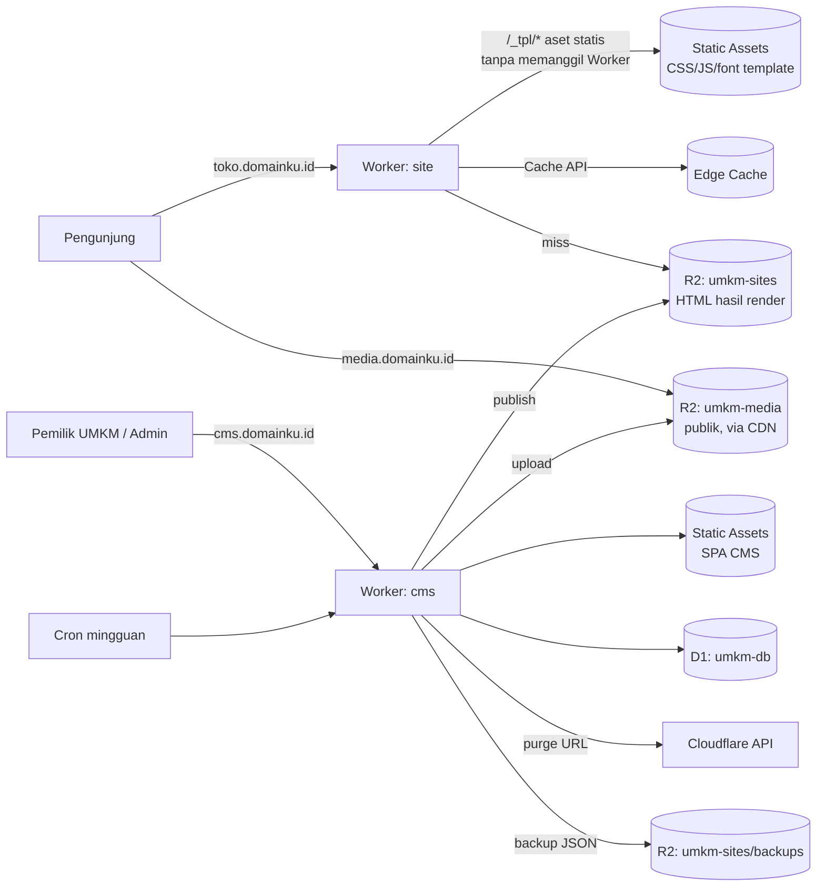
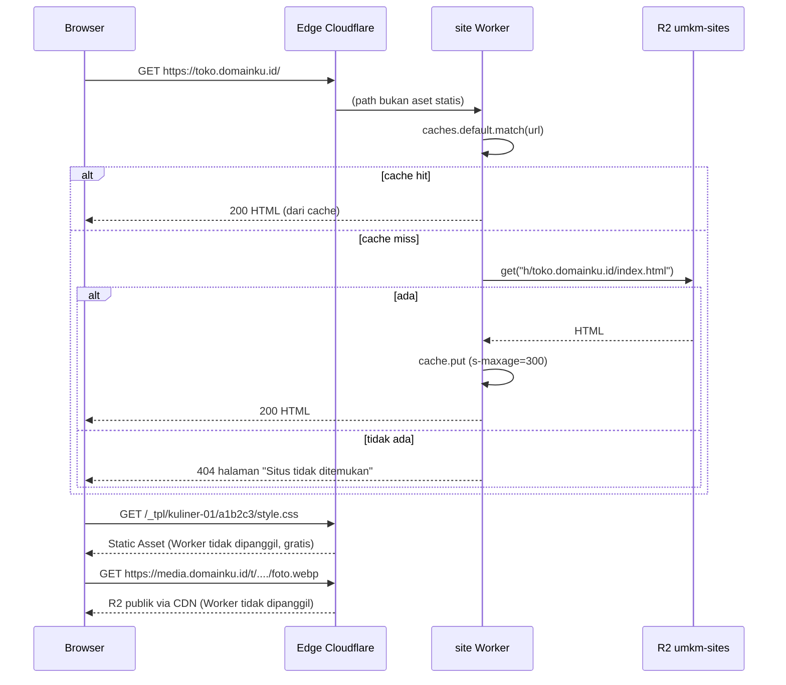
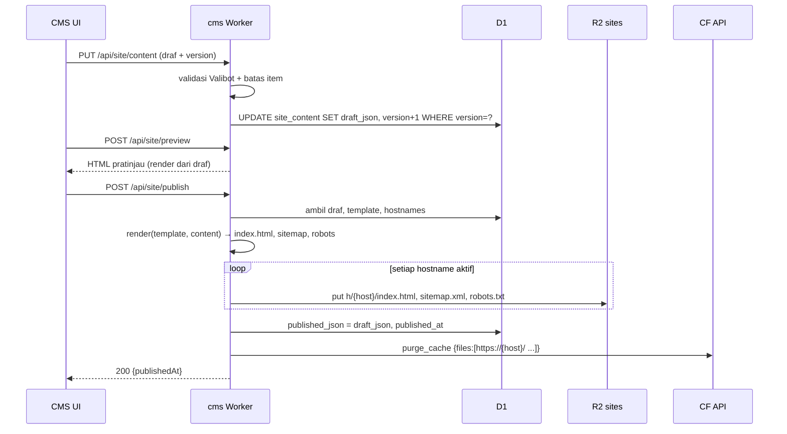

# TAD — Technical Architecture Document

Versi 1.0 · 18 November 2026 · Placeholder domain: `domainku.id`

---

## 1. Ringkasan Arsitektur

Dua Cloudflare Worker, satu database D1, dua bucket R2, semua dalam satu akun Cloudflare paket Free.



### Prinsip desain
1. **Satu page view = satu request Worker.** Semua aset lain (CSS, font, foto) dilayani tanpa Worker.
2. **Situs publik tidak pernah menyentuh D1.** D1 hanya dipakai CMS.
3. **Render saat terbit (SSG)**, bukan saat dikunjungi.
4. **Tanpa lookup hostname.** HTML disimpan di R2 dengan kunci berdasarkan hostname.
5. **Semua template = kode di repo**, bukan data di DB → versi terkendali, bisa diuji.

## 2. Komponen

| Komponen | Teknologi | Tanggung jawab |
|---|---|---|
| `site` Worker | Hono (opsional, bisa vanilla) | Melayani `*.domainku.id`: baca cache → R2 → respons + header keamanan |
| `site` Static Assets | Workers Static Assets | `/_tpl/{template}/{hash}/style.css`, font, ikon, favicon default |
| `cms` Worker | Hono + Drizzle ORM + Valibot | API CMS & admin, auth, render & publish, upload media, cron backup |
| `cms` Static Assets | Vite + Preact (SPA) | Antarmuka CMS pelanggan & panel admin |
| `umkm-db` | D1 | Pengguna, sesi, tenant, konten, media, pembayaran, audit |
| `umkm-sites` | R2 (privat) | HTML terbit per hostname, sitemap, robots, backup |
| `umkm-media` | R2 (publik via `media.domainku.id`) | Foto pelanggan (WebP) |
| Turnstile | Cloudflare Turnstile | Anti-bot di halaman login |
| WAF Rate Limiting | 1 rule (Free) | Batasi `POST /api/auth/login` |
| Cron Trigger | 1 dari 5 kuota | Backup D1 → R2 mingguan, bersih-bersih sesi kadaluarsa |

### Paket kode (monorepo pnpm)

```
apps/
  site-worker/        # Worker publik
  cms-worker/         # Worker API + host SPA
  cms-ui/             # SPA (build → cms-worker/public)
packages/
  content-schema/     # Skema konten (Valibot) + tipe TS — dipakai UI & Worker
  templates/          # 10 layout + 12 tema + registry 30 template + renderer
  shared/             # util: escape HTML, sanitasi URL, slug, crypto
scripts/
  build-templates.ts  # compile Tailwind per template → aset ber-hash
migrations/           # SQL migrasi D1
```

## 3. Alur Request

### 3.1 Kunjungan situs publik



**Pemetaan path di site Worker:**

| Path | Perilaku |
|---|---|
| `/` | `h/{host}/index.html` |
| `/sitemap.xml`, `/robots.txt` | `h/{host}/sitemap.xml`, `h/{host}/robots.txt` |
| `/_tpl/*`, `/favicon.ico` | Static Assets (tidak memanggil Worker) |
| lainnya | 301 ke `/` (situs one-page) |
| method selain GET/HEAD | 405 |

### 3.2 Edit & Terbitkan



- Purge cache bersifat *best-effort*. Kalau gagal, TTL 300 detik tetap menjamin perubahan tayang ≤ 5 menit.
- Kunci per hostname membuat **domain kustom (Fase 7)** cukup ditambah sebagai hostname baru tanpa mengubah site Worker.

### 3.3 Upload foto

1. Browser memilih foto → kompres & ubah ke WebP (maks 1600 px sisi terpanjang, kualitas 0,8, target ≤ 400 KB) memakai `<canvas>` / `createImageBitmap`.
2. `POST /api/media` (multipart) → Worker memeriksa sesi, kuota tenant, ukuran, dan *magic bytes* (WebP/JPEG/PNG).
3. Simpan ke `umkm-media` dengan kunci `t/{tenantId}/{uuid}.webp`, header `Cache-Control: public, max-age=31536000, immutable`.
4. Catat di tabel `media`. URL publik: `https://media.domainku.id/t/{tenantId}/{uuid}.webp`.

Foto tidak pernah ditimpa (nama acak). Mengganti foto = upload baru + hapus lama → tidak perlu purge cache.

### 3.4 Login

`POST /api/auth/login` → verifikasi Turnstile → ambil user → PBKDF2 → bandingkan constant-time → buat sesi (token acak 32 byte, simpan hash SHA-256 di D1) → set cookie `sid`.

## 4. Mesin Template & Render

### 4.1 Struktur
```
packages/templates/
  layouts/L01-hero-penuh.ts ... L10-elegan-serif.ts   # fungsi (ctx) => string HTML
  sections/                                            # hero, about, products, ... dipakai ulang antar layout
  themes/T01..T12.ts                                   # token: warna, font, radius, gaya tombol
  registry.ts                                          # 30 entri: { id, name, category, layout, theme, thumbnail }
  render.ts                                            # render(templateId, content, opts) → { html, sitemap, robots }
```

### 4.2 Aturan render
- Fungsi murni berbasis *template literal* dengan helper `html\`...\`` yang **meng-escape semua interpolasi secara default** (lihat SECURITY.md §5).
- Tanpa framework runtime → render < 2 ms CPU, aman untuk batas 10 ms paket Free.
- CSS: Tailwind dikompilasi per template saat build (hanya kelas yang dipakai), di-*hash* ke `/_tpl/{id}/{hash}/style.css`. CSS kritis (above-the-fold) di-*inline* di `<head>`.
- Font: maksimal 2 keluarga font self-hosted (WOFF2) di Static Assets, `font-display: swap`.
- JS: tidak ada JS wajib. Opsional ≤ 3 KB inline untuk menu HP & lightbox galeri.
- Output menyertakan: meta SEO, Open Graph, JSON-LD `LocalBusiness`, `<link rel="preconnect" href="https://media.domainku.id">`, dan `loading="lazy"` untuk gambar di bawah lipatan.

### 4.3 Versi template & *version skew*
- HTML terbit merujuk CSS ber-hash. Build menyimpan **hash lama minimal 2 versi** di Static Assets supaya HTML lama tidak rusak.
- Setelah perubahan template, admin menjalankan **"Terbitkan ulang semua"**. UI admin memanggil publish per tenant secara berurutan (100 situs ≈ 100 request), bukan satu request besar → aman dari batas 50 subrequest per invocation.

### 4.4 Pratinjau
`POST /api/site/preview` merender draf dan mengembalikan HTML ke `<iframe srcdoc>` di CMS. CSS pratinjau dilayani dari Static Assets milik `cms` Worker (build menyalin `_tpl` yang sama ke kedua Worker).

## 5. Caching

| Objek | Lapisan | TTL | Invalidasi |
|---|---|---|---|
| HTML situs | Cache API (per data center) | `s-maxage=300` | Purge URL via API saat publish + TTL |
| HTML situs (browser) | Browser | `max-age=0, must-revalidate` + ETag | ETag dari R2 |
| CSS/font template | Static Assets + browser | 1 tahun, immutable (nama ber-hash) | Ganti hash |
| Foto | CDN + browser | 1 tahun, immutable | Nama file baru |
| API CMS | — | `no-store` | — |

## 6. Kapasitas & Kuota (paket Free, diverifikasi 18 Nov 2026)

| Sumber daya | Batas Free | Perkiraan pemakaian 100 situs | Status |
|---|---|---|---|
| Workers request | 100.000 / hari (seluruh akun) | 100 situs × 300 page view = 30.000 + CMS ±2.000 | ✅ 32% |
| Workers CPU | 10 ms / request | Situs < 1 ms; render publish < 3 ms; PBKDF2 **perlu diukur** | ⚠️ lihat R-01 |
| Subrequest | 50 / invocation | Publish: ±4 put R2 per host + ±6 query D1 + 1 purge | ✅ |
| Static Assets request | Gratis, tak terbatas | Semua CSS/font | ✅ |
| Static Assets file | 20.000 file / versi | 30 template × ~5 file × 3 versi ≈ 450 | ✅ |
| D1 rows read | 5 juta / hari | ±50.000 (hanya CMS) | ✅ 1% |
| D1 rows written | 100.000 / hari | ±2.000 | ✅ |
| D1 storage | 500 MB / database | Konten JSON ±50 KB × 100 = 5 MB | ✅ |
| D1 Time Travel | 7 hari | Ditambah backup mingguan ke R2 | ✅ |
| R2 storage | 10 GB-bulan | Maks 15 MB × 100 = 1,5 GB + backup | ✅ 15–20% |
| R2 Class A (tulis) | 1 juta / bulan | Upload + publish ±20.000 | ✅ |
| R2 Class B (baca) | 10 juta / bulan | Cache miss HTML + foto (cache CDN) ±1–3 juta | ✅ |
| Cron Triggers | 5 / akun | 1 | ✅ |
| Cloudflare for SaaS | 100 hostname gratis, lalu $0,10/hostname | Fase 7 saja | ✅ |
| WAF Rate Limiting | 1 rule (Free) | 1 untuk login | ✅ |

> Batas 100.000 request Worker berlaku **per akun per hari** (reset 00:00 UTC = 07:00 WIB). Jika terlampaui, situs mengembalikan error 1027 sampai reset. Ini **risiko terbesar** di paket Free; lihat §8.

**Sumber:** developers.cloudflare.com — `workers/platform/limits`, `workers/static-assets/billing-and-limitations`, `d1/platform/limits`, `d1/platform/pricing`, `r2/pricing`, `kv/platform/limits`, `cloudflare-for-platforms/cloudflare-for-saas/plans`.

## 7. Keputusan Arsitektur (ADR ringkas)

| No | Keputusan | Alasan | Alternatif yang ditolak |
|---|---|---|---|
| ADR-01 | HTML di R2, dilayani Worker + Cache API | Satu deployment untuk semua tenant; publish tanpa redeploy | Pages per tenant (melanggar "satu deployment", batas proyek); Static Assets per tenant (butuh redeploy) |
| ADR-02 | Kunci R2 berdasarkan hostname | Tanpa lookup DB/KV saat kunjungan | Lookup D1 per request (boros rows read & latensi); KV (read 100k/hari = sama dengan kuota Worker) |
| ADR-03 | Foto via R2 custom domain publik | Tidak memakai kuota Worker; cache CDN | Melayani foto lewat Worker |
| ADR-04 | Konten sebagai satu dokumen JSON per tenant | Skema sama untuk 30 template; ganti template tanpa migrasi | Tabel ternormalisasi per section (rumit, tanpa manfaat di skala ini) |
| ADR-05 | Sesi di D1, bukan KV | KV Free hanya 1.000 tulis/hari | KV, JWT tanpa state (tidak bisa dicabut) |
| ADR-06 | PBKDF2 WebCrypto | Native, tanpa dependensi, tersedia di Workers | bcrypt/argon2 WASM (berat, berisiko melewati 10 ms CPU) |
| ADR-07 | Template sebagai kode (template literal) | Render cepat, bundel kecil, bisa diuji unit | React SSR / Astro (terlalu berat untuk 10 ms, Astro tidak bisa build di Worker) |
| ADR-08 | Dua Worker (`site`, `cms`) | Isolasi: bug CMS tidak menjatuhkan situs publik; bundel `site` sangat kecil | Satu Worker |
| ADR-09 | Valibot untuk validasi | Bundel jauh lebih kecil dari Zod, CPU rendah | Zod |
| ADR-10 | One-page di v1 | Sederhana, cocok UMKM, 1 request per kunjungan | Multi-halaman |

## 8. Bottleneck & Risiko Infrastruktur

| ID | Risiko | Dampak | Mitigasi |
|---|---|---|---|
| R-01 | PBKDF2 melewati 10 ms CPU di Free | Login gagal (error 1102) | Ukur di Fase 1. Iterasi disimpan per user (`pw_iter`) → mulai 100.000; turunkan ke 50.000–60.000 jika perlu (tetap aman dengan rate limit + Turnstile + lockout) |
| R-02 | Kuota 100k request/hari terlampaui (situs viral, bot) | Semua situs error 1027 sampai 07:00 WIB | Static Assets & foto tanpa Worker; aturan WAF blok bot jahat; pantau Analytics; ambang upgrade ke Workers Paid $5 jika rata-rata > 50k/hari |
| R-03 | Bot menyerang CMS | Menghabiskan kuota | Turnstile, rate limit login, CMS tidak di-index (`noindex`) |
| R-04 | Cache API bersifat per data center | Perubahan bisa butuh hingga 5 menit di lokasi lain | Purge URL via API + TTL pendek |
| R-05 | Version skew CSS template | Tampilan rusak pada HTML lama | Simpan 2 versi hash lama + republish all |
| R-06 | Storage R2 tumbuh karena foto | Melewati 10 GB | Kompresi di browser, kuota per tenant, hapus media yatim via cron |
| R-07 | D1 satu region (latensi CMS dari Indonesia) | CMS sedikit lambat (±150–300 ms) | Wajar untuk CMS; situs publik tidak terdampak |
| R-08 | Tidak ada SLA paket Free | Gangguan tanpa kompensasi | Sampaikan di syarat layanan; backup rutin |
| R-09 | Kesalahan isolasi tenant di kode | Kebocoran data | Repository wajib `tenantId`, uji otomatis lintas tenant (SECURITY.md §3) |

## 9. Jalur Peningkatan

| Pemicu | Tindakan | Biaya |
|---|---|---|
| > 50k request/hari rata-rata, atau CPU login bermasalah | Workers Paid | $5/bulan |
| Pelanggan minta domain sendiri | Aktifkan Cloudflare for SaaS (Fase 7) | Gratis s.d. 100 hostname |
| > 500 situs | Workers Paid + Queues/Workflows untuk republish massal | $5/bulan + pemakaian |
| Butuh resize gambar dinamis | Cloudflare Images (transformasi) | Sesuai paket |
